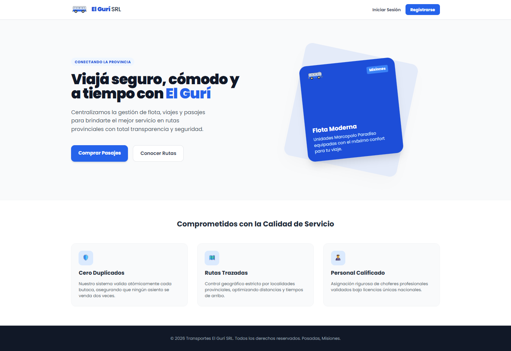
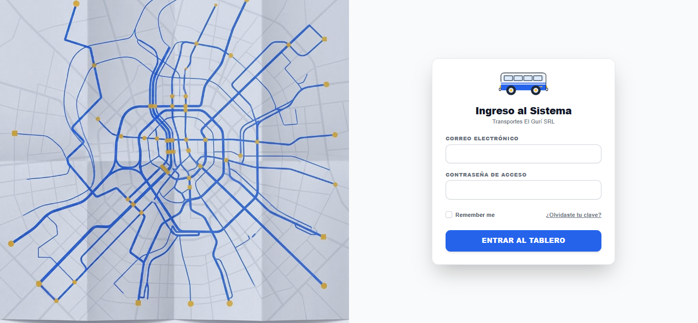
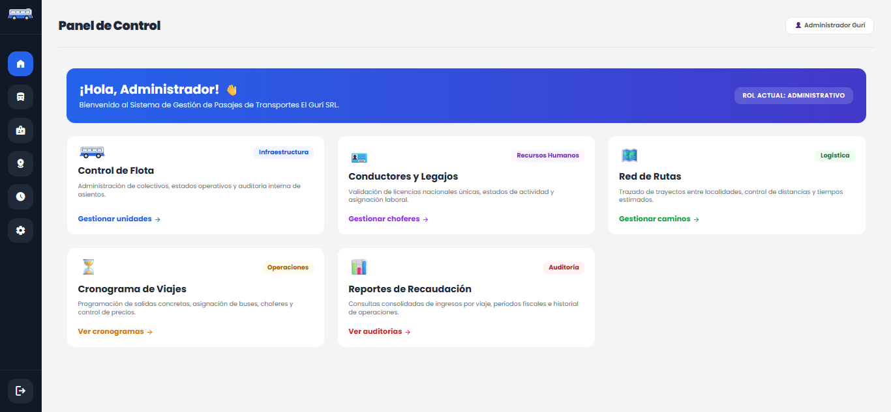
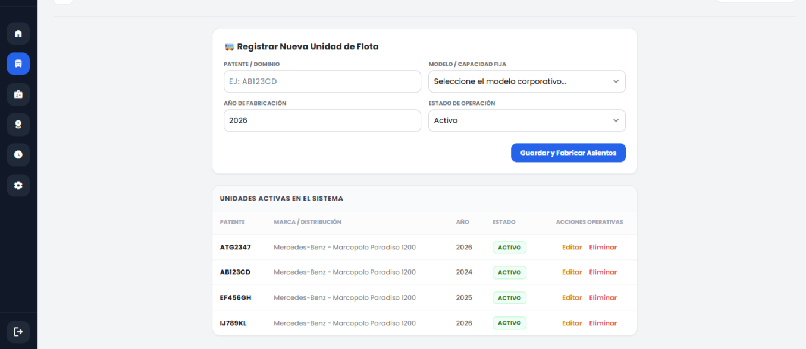
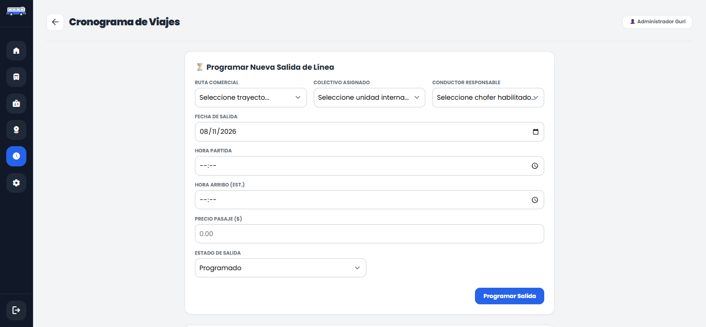

# Proyecto Guri Srl en Laravel 11.4
### Lista de Recursos : Compatibilidad librerias con https://packagist.org/  
### Dashboard: https://laravel.com/framework/docs/11.x/starter-kits#laravel-breeze-installation
### Roles y Permisos : https://spatie.be/docs/laravel-permission/v8/installation-laravel
 
### Comandos Git: Resolver conflictos: https://www.freecodecamp.org/espanol/news/git-pull-force-como-sobre-escribir-los-cambios-locales-con-git/
 
### Iconos de GoogleFonts: https://fonts.google.com/icons   https://www.svgrepo.com/vectors/bus-transport/  https://favicon.io/favicon-converter/
### Modelo de tabla: https://www.tailwindtoolbox.com/components/responsive-table
### Modelo de formulario: https://tailwindui.com/components/application-ui/forms/form-layouts

### Imagenes del Sitio







### Levantar el proyecto

1. **Clonar el repositorio**
   ```bash
   git clone https://github.com
   ```

2. **Instalar las dependencias**
-Navega a la carpeta del proyecto e instala lo necesario:
   ```bash
   cd tu-proyecto
   npm o pnpm install
   composer install
   ```
3. **Copia el example y genera tu env.** 
- configura según lo que utilices
```bash
php artisan:key generate
```

#DB_CONNECTION=sqlite
# DB_HOST=127.0.0.1
# DB_PORT=3306
# DB_DATABASE=laravel
# DB_USERNAME=root
# DB_PASSWORD=
    

1. **levantar db php artisan migrate**
- correr los seeder  
```bash
php artisan migrate:fresh --seed 
php artisan db:seed --class=RolesAndPermissionsSeeder
php artisan db:seed --class=UserSeeder 
php artisan serve --host=localhost --port=8080  , pnpm run dev
```